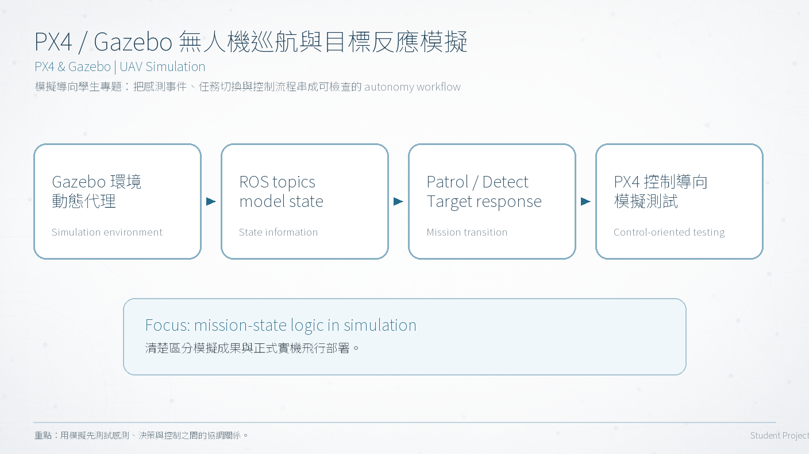

# PX4 Shepherding Simulation

[Portfolio case study](https://scandial-portfolio.scandium.chatgpt.site/project-px4.html) · This case study documents integration and simulation evidence. The source controller and launch configuration are outside this release.

A simulation-first integration prototype that connects a Python finite-state controller to PX4 SITL and Gazebo Classic through MAVROS. The project explores a shepherding-style multi-agent scenario; it is not a flight-tested autonomous system.



## Stack

- PX4 SITL `v1.14.0-rc1`
- Gazebo Classic 11
- ROS Noetic and MAVROS
- Python 3.8 controller

## Control structure

The archived simulator controller distinguishes five runtime states. Initialization includes offboard setup, arming and takeoff. After setup, the simulation progresses through patrol, approach, follow and return phases. The portfolio describes the observed Gazebo behavior and the limits of that evidence.

## Evidence and limitations

The included figure documents the intended simulation integration. The work demonstrates SITL, ROS, MAVROS, and Python-controller integration. It does **not** claim real-world flight performance, vision-detector completion, collision safety, or field validation. See [docs/evidence.md](docs/evidence.md).

## Replay the documented state transitions

With Python 3.10 or later, run:

~~~bash
python tools/replay_states.py
python tools/replay_states.py examples/target_lost.json
python -m unittest discover -s tests -v
~~~

The first fixture follows setup, patrol, approach, follow, return and renewed patrol. The second verifies that the state returns to patrol after a lost simulated observation. The offline replay validates state transitions against synthetic events. It uses no ROS installation, PX4 connection, flight commands, or real vehicle telemetry.

## Repository layout

```text
assets/       Public simulation overview
docs/         Evidence scope and reproducibility boundary
examples/     Synthetic event fixtures for offline state replay
tests/        Offline finite-state transition tests
tools/        Offline state replay CLI (replay_states.py)
```

## Reuse

This is a portfolio case study, not a ready-to-fly vehicle package. Rebuild the simulation with your own PX4, Gazebo, ROS, and vehicle configuration before extending it.

## License

Apache-2.0. See [LICENSE](LICENSE).

## Simulation states

| Current state | Observed transitions in the archived controller |
| --- | --- |
| Initializing | Patrol after successful setup |
| Patrol | Approach after a simulated target enters the patrol area |
| Approach | Patrol when the target is lost, or follow after the simulated trigger path |
| Follow | Return to patrol area, or resume patrol when the target is lost |
| Return to patrol area | Patrol after reaching the return waypoint |

Target position in this snapshot comes from Gazebo model state. This document outlines control flow for review. The reproducibility prerequisites in [docs/evidence.md](docs/evidence.md) still apply.
